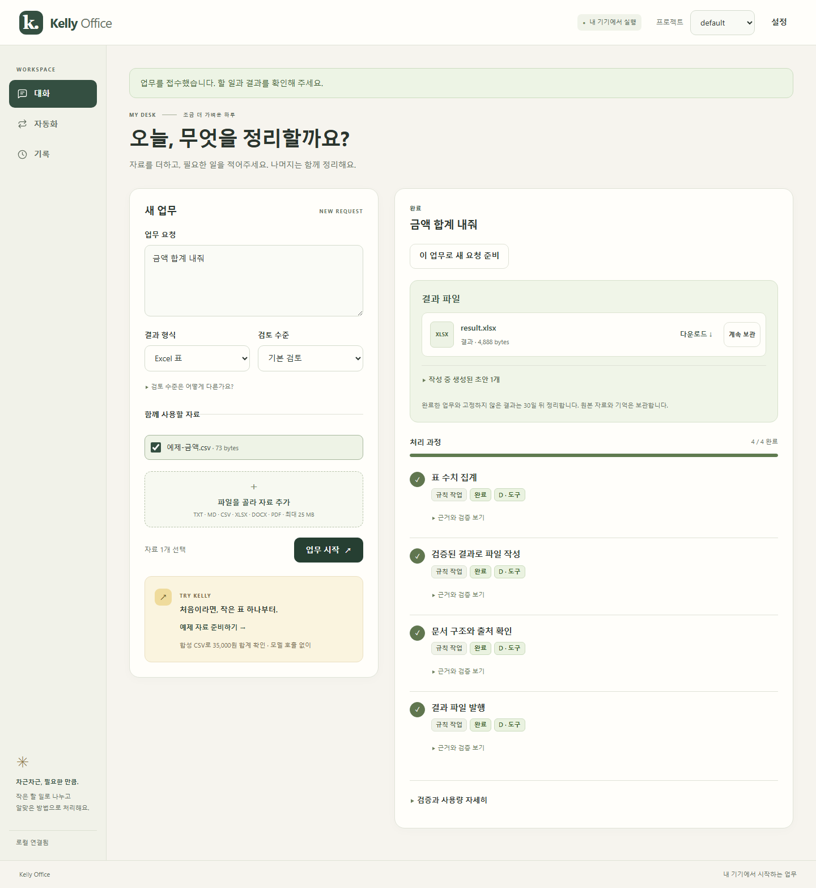

# Kelly Office Agent

[English](README.md) · 한국어


**일상 업무에, 필요한 만큼의 AI.**

Kelly는 요청을 TODO 목록으로 만들면서 각 단계의 복잡도를 판단하고, 도구나 적격 모델에 일을 배정하는 로컬 오피스 에이전트입니다. 문서 작업, 결과 확인, 반복 업무 봇, 업무 기억을 하나의 웹 화면에서 다룹니다.

**현재 초기 프리뷰입니다.** API 키 없이 표 계산 예제를 실행할 수 있습니다. AI 업무에는 품질 검증을 거친 모델 설정이 필요하며, 키를 입력하는 것만으로 모델이 적격 상태가 되지는 않습니다. 비교 평가를 통한 토큰 절감 효과는 아직 확인되지 않았습니다.

## Windows에서 시작하기

**Windows, Python 3.12 이상, uv, Git, 브라우저**가 필요합니다. 현재 파일 보안 기능은 Windows API를 사용합니다. 기본 예제 실행에는 Microsoft Office 설치가 필요하지 않습니다. 웹 화면은 한국어로 제공됩니다.

PowerShell에서 실행하세요.

```powershell
git clone https://github.com/ashmoonori-afk/Kelly-office-agent.git
cd Kelly-office-agent
uv sync --locked --no-dev
uv run --locked --no-dev kelly serve --config config.json
```

처음 실행하면 `config.json`과 로컬 데이터 폴더가 생성됩니다. [http://127.0.0.1:8765](http://127.0.0.1:8765)를 열고, 같은 폴더의 다른 터미널에서 연결 코드를 발급하세요.

```powershell
uv run --locked --no-dev kelly serve --config config.json --access-code
```

코드를 입력한 뒤 **예제 자료 준비하기 → 업무 시작**을 누르세요. `12,000 + 8,000 + 15,000`을 계산해 합계 **35,000**의 XLSX를 만들고 원본 CSV를 보존합니다. 이 업무의 **모델 호출은 0회**입니다.

서버 터미널에서 **Ctrl+C**를 누르면 종료합니다. 봇은 PC와 서버가 실행 중일 때 동작합니다. 기존 `blite` 명령도 호환용으로 유지됩니다.



합성 예제 자료로 실행한 실제 로컬 브라우저 화면입니다. [좁은 화면 배치 보기](assets/kelly-mobile.png).

## 할 수 있는 일

- **파일 작업:** 표를 집계하고 XLSX·DOCX·CSV·Markdown·텍스트 결과를 새로 만듭니다. 숫자, 근거 위치, 출력 구조를 확인합니다.
- **필요한 단계의 AI 처리:** 문서 요약, 회의 할 일 추출, 보고서·답장 초안, 제공한 자료에 근거한 답변을 처리합니다. 적격 모델이 필요한 업무입니다.
- **직접 켜는 업무 봇:** 일회·매일·매주·일정 간격·허용한 폴더의 변경을 조건으로 실행합니다. 범위 검토, 일시정지, 실행 기록을 제공합니다.
- **결과 검토:** TODO 진행을 확인하고, 부족한 입력을 보완하며, 결과를 내려받습니다. 중간에 실패해도 완료한 부분은 남깁니다.
- **명시적 업무 기억:** 선호와 결정을 직접 저장·수정·검색·삭제합니다. 계속 보관할 결과는 고정할 수 있습니다.

선택 기능인 Telegram은 연결한 소유자의 텍스트 요청, 승인 버튼, 결과 전달을 지원합니다. 클라우드 전송과 Telegram은 기본 비활성 상태입니다.

## 업무 복잡도로 배정합니다

| 배정 | 맡기는 일 |
|---|---|
| **D — 도구** | 모델 없이 계산할 수 있는 수치·파일 처리와 검증 |
| **L — 단순** | 범위가 좁고 요구가 명확한 언어 작업 |
| **M — 일반** | 통상적인 해석과 범위가 정해진 계획 |
| **H — 복합** | 근거 충돌, 서로 얽힌 조건, 의미 검토 |

단계의 복잡도와 필요한 기능으로 배정하며, 가격이나 남은 예산은 모델 선택에 넣지 않습니다. 전달할 문맥과 재시도를 제한하고, 재사용 조건을 충족한 캐시를 활용합니다. 사용량은 실제 관측값과 확인되지 않은 값을 구분해 기록합니다.

**정밀 검토**를 선택하면 생성한 글에 의미 검토를 추가로 요청합니다. 계산은 계속 도구가 처리합니다.

## 프리뷰의 현재 범위

현재 클라우드 연결은 **xAI**를 지원합니다. 모델 가용성, 프로젝트 권한, 기능, 일치하는 품질 근거를 모두 확인해야 업무에 투입합니다. 실제 모델의 품질 자격 검증과 전체 A/B/C 업무 비교는 아직 완료되지 않았습니다.

Windows CI에서 로컬 파일·DB·브라우저·daemon 업무 흐름과 독립 설치·재시작·백업·복구·제거를 검사합니다. 실제 공급자·Telegram 연결의 최종 확인, 전체 접근성, Office 화면 배치 검증은 남아 있습니다. 문서 구조 검사 통과가 화면 배치까지 보장하지는 않습니다. 실측한 절감률을 제시하는 정식 출시 상태는 아닙니다.

## 설정과 운영

- [모델 설정과 명시적 연결 검사](docs/PROVIDER.md)
- [모델 후보 시험과 업무 비교 평가](evals/README.md)
- [Telegram 설정과 전달 복구](docs/TELEGRAM.md)
- [로컬 점검·로그 내보내기·백업·복구](docs/OPERATIONS.md)
- [30일 보관 정리와 결과 고정](docs/RETENTION.md)

Python import 이름은 `kelly`입니다. 이전 `birkin_lite` import와 `blite` 명령은 한 릴리스 동안 유지합니다. 기존 `blite_session` 쿠키도 같은 기간 허용하며 새 세션은 `kelly_session`을 사용합니다.

[MIT 라이선스](LICENSE) · [외부 코드 고지](docs/THIRD_PARTY.md)
