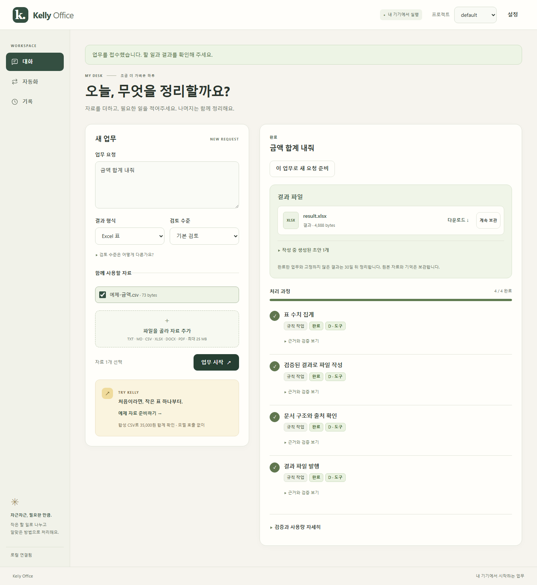

> [!IMPORTANT]
> **Kelly is being rebuilt from scratch.** Beta testing is expected in December 2026. Apply to be a beta tester: https://forms.gle/PUt9tuCtrU1YcTnf8
>
> Kelly는 지금 처음부터 새로 만들고 있습니다. 베타 테스트는 2026년 12월 예정이며, 테스트 사용 신청은 여기서 받습니다: https://forms.gle/PUt9tuCtrU1YcTnf8

# Kelly Office Agent

English · [한국어](README.ko.md)


**Everyday office work, with the right amount of AI.**

Kelly turns a request into a TODO list, judges each step's complexity as it plans, and assigns deterministic tools or a qualified model. A local web app brings documents, results, recurring bots, and saved work preferences together.

**Early preview.** Try the spreadsheet example without an API key. AI workflows require qualified model profiles; adding a key alone does not qualify a model. Token savings have not yet been established by comparative evaluation.

## Try it on Windows

You need **Windows, Python 3.12+, uv, Git, and a browser**. The file security layer currently depends on Windows APIs. Microsoft Office is not required for the built-in example. The web UI is currently in Korean.

In PowerShell:

```powershell
git clone https://github.com/ashmoonori-afk/Kelly-office-agent.git
cd Kelly-office-agent
uv sync --locked --no-dev
uv run --locked --no-dev kelly serve --config config.json
```

The first launch creates `config.json` and a local data directory. Open [http://127.0.0.1:8765](http://127.0.0.1:8765). In another terminal, from the same directory, issue a connection code:

```powershell
uv run --locked --no-dev kelly serve --config config.json --access-code
```

Enter the code, then choose **예제 자료 준비하기** (Prepare example) → **업무 시작** (Start task). Kelly adds `12,000 + 8,000 + 15,000` and produces an XLSX with a total of **35,000**, preserving the source CSV. This workflow makes **zero model calls**.

Stop the server with **Ctrl+C** in its terminal. Bots execute while the server and PC are running. The former `blite` command remains a compatibility alias.



Actual local browser screenshot with synthetic sample data. [View the narrow-screen layout](assets/kelly-mobile.png).

## What Kelly does

- **Work with files:** aggregate tables and create new XLSX, DOCX, CSV, Markdown, or text results. Check numbers, source references, and output structure.
- **Use AI where needed:** document summaries, meeting action items, report drafts, reply drafts, and answers from supplied sources. These workflows require qualified models.
- **Run bots you enable:** once, daily, weekly, interval, or approved folder-change triggers, with a scope preview, pause controls, and durable execution records.
- **Review results:** follow TODO progress, supply missing information, download outputs, and keep completed partial work after a failure.
- **Keep explicit memories:** save, edit, search, and remove work preferences and decisions. Pin results for continued retention.

Optional Telegram integration supports paired owner text requests, approval buttons, and result delivery. Cloud access and Telegram are disabled by default.

## Complexity determines the route

| Route | Work assigned |
|---|---|
| **D — deterministic tools** | Calculation, file operations, and checks that need no model |
| **L — simple** | Clear, narrowly scoped language tasks |
| **M — standard** | Routine interpretation and bounded planning |
| **H — complex** | Conflicting evidence, coupled constraints, and semantic review |

Routes use task complexity and required capabilities. Prices and remaining spend do not determine model assignment. Kelly limits context and retries, reuses eligible cached results, and records actual or unknown usage instead of inventing token counts.

**정밀 검토** (Detailed review) requests additional semantic review of generated text. Calculations remain deterministic.

## Preview boundaries

The current cloud adapter is **xAI**. Model availability, project permission, capabilities, and matching quality evidence must all pass before a model can handle work. Live model qualification and the full A/B/C workload comparison are unfinished.

Windows CI checks local file, database, browser, and daemon workflows, plus an isolated install, restart, backup, restore, and uninstall. Live provider/Telegram acceptance, full accessibility, and Office layout verification remain incomplete. A document's structural checks do not guarantee its visual layout. This is a preview, with no measured percentage savings claim.

## Setup and maintenance

- [Model configuration and an explicit connection probe](docs/PROVIDER.md)
- [Candidate qualification and workload evaluation](evals/README.md)
- [Telegram setup and delivery recovery](docs/TELEGRAM.md)
- [Local diagnostics, log export, backup, and restore](docs/OPERATIONS.md)
- [30-day retention and pinned results](docs/RETENTION.md)

The Python import namespace is `kelly`. The deprecated `birkin_lite` import and
`blite` command remain available for one release. Existing `blite_session` cookies
are accepted during this transition; new sessions use `kelly_session`.

[MIT license](LICENSE) · [Third-party notices](docs/THIRD_PARTY.md)
